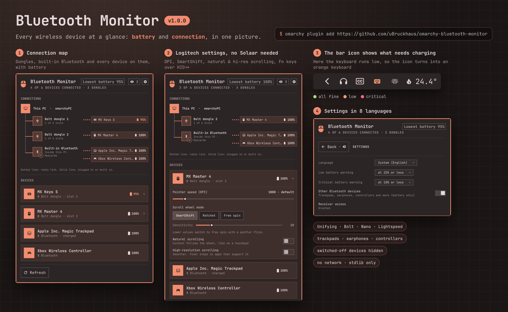

# Bluetooth Monitor

**Every wireless device at a glance: battery and connection, in one picture.**



Mice, keyboards, trackpads, earphones and game controllers: Bluetooth Monitor shows how full
each battery is and how each device reaches your PC, over Bluetooth or through a Logitech USB
dongle (Unifying, Bolt, Nano, Lightspeed).

- **Connection map.** A tree of this PC, every dongle and Bluetooth adapter (solid line:
  plugged in or built in) and the devices on each (dotted line: radio), with their battery.
  You see which dongle a device needs, which dongle has free slots and whether your Bluetooth
  is built into the PC or a USB stick.
- **A bar icon that stays quiet until it matters.** Green while every battery is fine,
  **orange** when one runs low, **red** when one is critical, and it turns into the device
  that needs charging: keyboard, trackpad, earphones, controller (mouse on a tie).
- **Only what is switched on.** Devices that are off are hidden; the eye button in the
  header shows them (with how many there are).
- **Logitech settings without Solaar or Logi Options**, straight over Logitech's HID++
  protocol, when the device supports them: pointer speed (DPI), SmartShift / ratchet /
  free-spin scroll wheel and its sensitivity, natural and high-resolution scrolling, Fn-key
  swap. Changed settings are written again when a device reconnects.

## Languages and settings

The gear in the panel opens the settings page (back with the button, Backspace or Esc):

- **Language**: the system language (default) or English, Deutsch, Français, Español,
  Italiano, Português, Nederlands, Polski
- **Low / critical battery warning**: when the bar icon turns orange / red (25 % and 10 %
  by default)
- **Other Bluetooth devices**: show trackpads, earphones, controllers and other devices
  that report a battery (on by default)
- **Receiver access**: whether Logitech receivers can be read, with the button to allow it

Choices are stored in the widget's own entry in `~/.config/omarchy/shell.json`.

## Install

Requires Omarchy's plugin-capable Quickshell, `python3` (standard library only) and UPower
(`upower`, installed on Omarchy). No setup script is needed.

```sh
omarchy plugin add https://github.com/uBruckhaus/omarchy-bluetooth-monitor
omarchy plugin enable ubruckhaus.bluetooth-monitor
```

Bluetooth devices appear right away. **Logitech receivers need one permission step**, because
Linux lets only root read `/dev/hidraw`: open the panel and click **Allow access** (also under
gear → Receiver access). See the next section for exactly what that does.

## Permissions (Logitech receivers only)

**Allow access** runs `scripts/allow-access.sh` through `pkexec`, so your system asks for your
password once. The script writes one file, `/etc/udev/rules.d/42-omarchy-logitech-devices.rules`,
and reloads udev. The rule tags `hidraw` nodes of USB devices with Logitech's vendor id (`046d`)
and Logitech Bluetooth devices with `uaccess`, which gives the user logged in at the seat (and
nobody else) read and write access to them while logged in. It is the same scope as the rule
Solaar installs. Nothing runs as root at any other time; the plugin never asks again unless you
remove the rule.

Write access to a receiver is what lets the plugin change DPI or SmartShift; like Solaar, it
would in principle also allow a firmware update, which this plugin never does. If you only want
battery levels from Bluetooth devices, skip the button: everything else works without it.

To revoke the access:

```sh
sudo rm /etc/udev/rules.d/42-omarchy-logitech-devices.rules
sudo udevadm control --reload-rules && sudo udevadm trigger --subsystem-match=hidraw
```

## How it works

- `scripts/bluetooth-monitor.py` (Python standard library) runs while the widget is loaded. It
  talks HID++ to Logitech receivers and devices over `/dev/hidraw` (pairing slots, names,
  battery, DPI, SmartShift, wheel and Fn settings) and reads other devices' batteries from
  `upower --dump`. A `upower --monitor` child, tied to the helper's lifetime, triggers a rescan
  when a device connects or a battery changes; otherwise it checks every 60 s (10 s while the
  panel is open).
- The Bluetooth adapter counts as built in when it is not on USB, sits on a fixed USB port,
  or comes from a maker of internal Wi-Fi/Bluetooth cards (Intel, MediaTek, AzureWave,
  Foxconn, Qualcomm, Lite-On); otherwise it is shown as a USB Bluetooth stick.
- Device names come from the devices themselves; they are shown as plain text with markup and
  control characters removed.

**Privacy:** the plugin makes no network requests. It reads sysfs, `/dev/hidraw` of Logitech
devices and UPower, and writes only `~/.config/omarchy/bluetooth-monitor/settings.json` (the
Logitech settings you changed) and its entry in `shell.json`.

## Update or remove

```sh
omarchy plugin update ubruckhaus.bluetooth-monitor
```

```sh
omarchy plugin disable ubruckhaus.bluetooth-monitor
omarchy plugin remove ubruckhaus.bluetooth-monitor
rm -r ~/.config/omarchy/bluetooth-monitor   # remembered Logitech settings, if any
```

If you allowed receiver access, remove the udev rule as shown under Permissions.

## Development

```sh
python3 -m unittest discover -s tests
omarchy plugin validate .
```

The tests cover HID++ parsing (pairing slots, DPI ranges, battery features), UPower output,
adapter detection, a flooding device, endless or silent child processes and markup in device
names. `I18n.js` is generated from a shared translation table by the author's i18n tool.

## License

MIT
